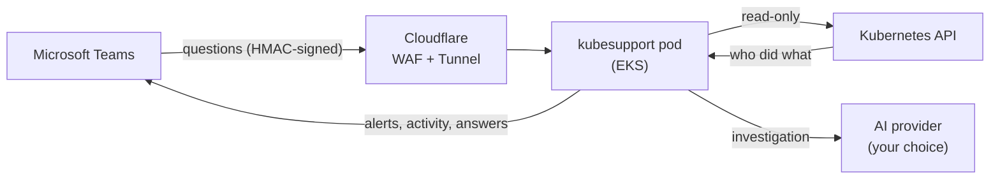

# Agent-Kube — kubesupport for EKS with Microsoft Teams

**kubesupport** is a read-only Kubernetes support agent that runs as one pod in your EKS cluster:

- **Sees the whole cluster, read-only:** every object in every namespace, plus nodes, RBAC and CRDs. Never Secrets, and it never changes anything.
- **Watches** for crash loops, OOM kills, image-pull failures, config errors, stuck Pending pods, pods that can't be created, failed Jobs, evictions and NotReady nodes.
- **Diagnoses** each new incident with the **AI provider of your choice** (Groq, Claude, Cursor, Gemini, OpenAI, Azure OpenAI, OpenRouter, Mistral, Ollama or any OpenAI-compatible API), or with evidence-based built-in rules. One Docker image supports them all; `LLM_PROVIDER` picks one.
- **Alerts your Microsoft Teams chat and channels** (private channels included) with the root cause and fix steps, then a "Resolved" card when it's over.
- **Reports cluster activity:** once a minute, *who* exec'd into a pod, created or deleted a service or app, changed permissions, or changed an image or replica count.
- **Answers questions in a Teams channel:** `@kubesupport status`, `@kubesupport get services payments`, `@kubesupport activity`, or any question in plain words.
- **Keeps itself private:** a question about kubesupport's own setup, AI model, rules or namespace gets "You are not authorised to ask this question", and the administrators get a card saying who asked what.

Teams is wired up with configuration only (Workflows webhooks and an outgoing webhook): no Azure Bot Service, no Entra app registration, no Teams app package. Nothing in AWS is exposed to the internet: questions from Teams arrive through a Cloudflare Tunnel that the cluster opens outward.



**Quick start:** follow [docs/INSTALLATION.md](docs/INSTALLATION.md) from Step 0 to Step 9:
- the Docker Hub image;
- EKS checks;
- the Teams webhooks;
- the AI provider and the Secret;
- `deploy/deployment.yaml`;
- activity notices;
- the Cloudflare Tunnel;
- an end-to-end test.

---

## Documentation

All documentation is in [`docs/`](docs). This README is the only index.

| # | Document | Read it to learn |
|---|---|---|
| 1 | [ARCHITECTURE.md](docs/ARCHITECTURE.md) | What kubesupport does and how it is built: components, the four flows (alerts, questions, activity, AI investigation) as diagrams, and the design decisions |
| 2 | [RULES.md](docs/RULES.md) | Every rule it applies: what counts as an incident, when cards are sent, the AI's rules, the built-in diagnosis rules, activity filtering, and the boundaries (what may not be asked) |
| 3 | [CODE_WALKTHROUGH.md](docs/CODE_WALKTHROUGH.md) | The code module by module, how a request moves through it, the tests, and how to extend it |
| 4 | [AI_PROVIDERS.md](docs/AI_PROVIDERS.md) | Every supported AI provider and how to switch |
| 5 | [INSTALLATION.md](docs/INSTALLATION.md) | Installing it in an EKS cluster and connecting Teams, step by step, with a check after each step |
| 6 | [USAGE.md](docs/USAGE.md) | What arrives in Teams, the commands people can type, the internal API and the command line |
| 7 | [CONFIGURATION_REFERENCE.md](docs/CONFIGURATION_REFERENCE.md) | Every setting in the ConfigMap and the Secret |
| 8 | [SECURITY.md](docs/SECURITY.md) | The security layers and exactly what leaves the cluster |
| 9 | [OPERATIONS.md](docs/OPERATIONS.md) | Day-to-day tasks, health checks, troubleshooting, limitations and cost |

| You are… | Read |
|---|---|
| A **developer** taking over the code | ARCHITECTURE → RULES → CODE_WALKTHROUGH → AI_PROVIDERS |
| An **operator** installing it in another cluster | INSTALLATION → CONFIGURATION_REFERENCE → OPERATIONS |
| A **Teams user** | USAGE, section 2 |
| A **reviewer** (security, platform) | SECURITY → RULES → ARCHITECTURE, section 6 |

## Repository

| Path | Contents |
|---|---|
| [agent/](agent) | The application (Python 3.12), its Dockerfile and tests |
| [agent/providers/](agent/providers) | AI providers, one folder; `LLM_PROVIDER` picks one |
| [agent/runbooks/](agent/runbooks) | Short fix notes the AI model can search (application data, not documentation) |
| [deploy/deployment.yaml](deploy/deployment.yaml) | Namespace, read-only RBAC, settings, Deployment, Services, NetworkPolicy |
| [deploy/cloudflare-tunnel.yaml](deploy/cloudflare-tunnel.yaml) | Cloudflare Tunnel for questions from Teams |
| [deploy/webhook-cert.sh](deploy/webhook-cert.sh) | Activity notices setup (applies [deploy/activity-webhook.yaml](deploy/activity-webhook.yaml)) |
| [.github/workflows/ci.yml](.github/workflows/ci.yml) | Lint and tests on every push; builds and pushes the image to Docker Hub on `main` |

## Development

```bash
cd agent
pip install -r requirements-dev.txt
pytest tests -q                                  # no cluster, AI provider or Teams needed
```

More in [docs/CODE_WALKTHROUGH.md](docs/CODE_WALKTHROUGH.md#9-local-development).
