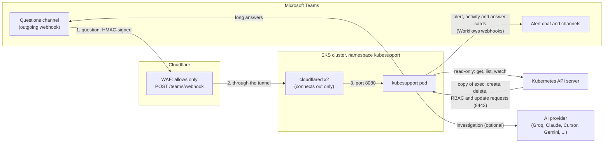
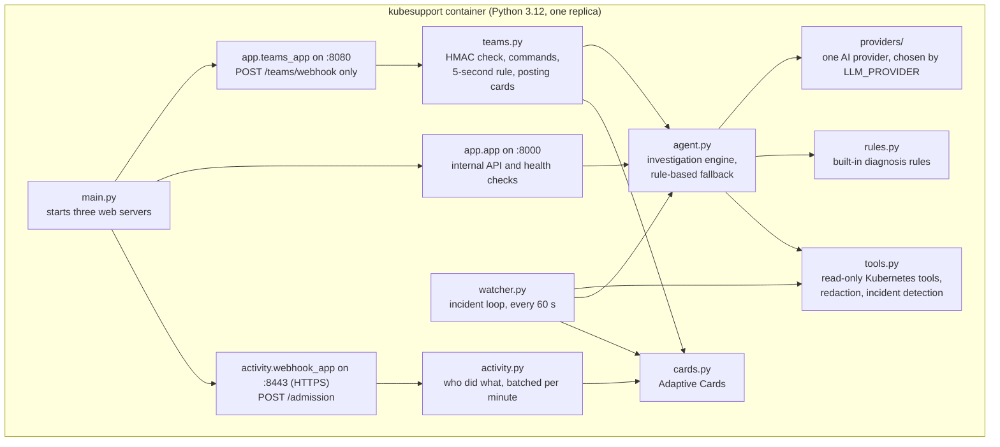
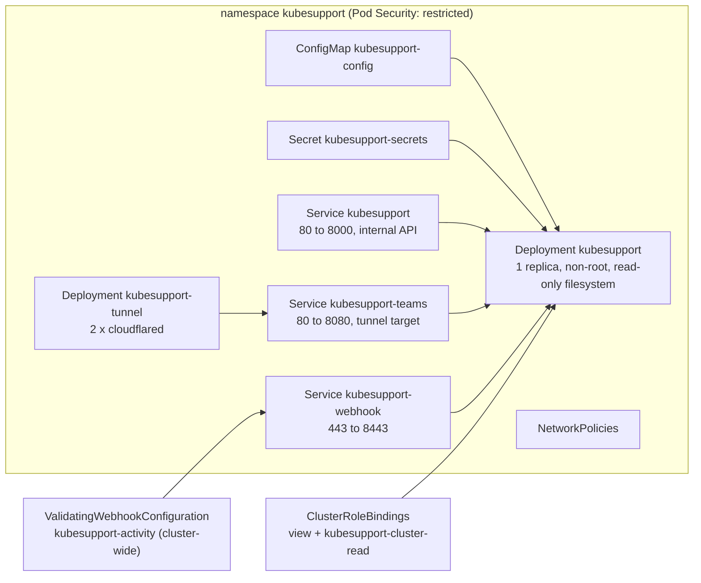
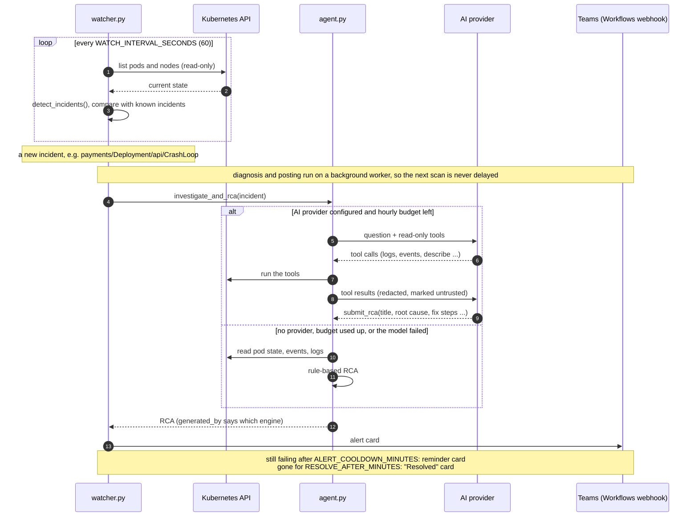
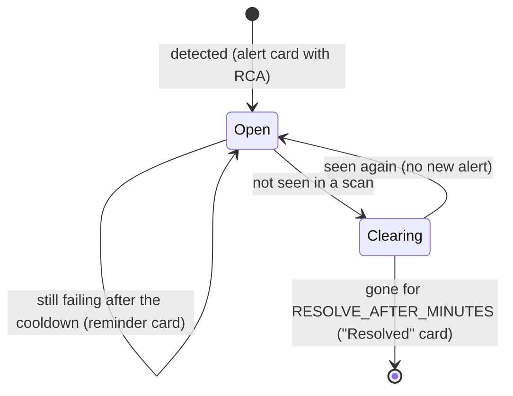
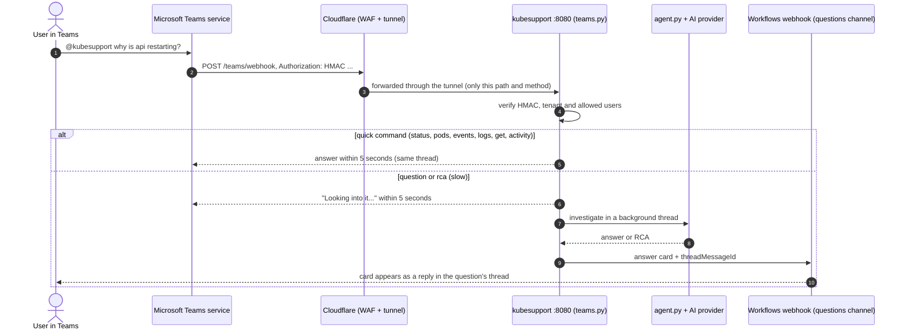
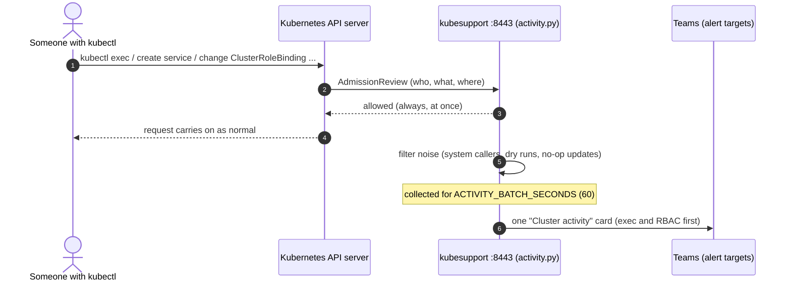
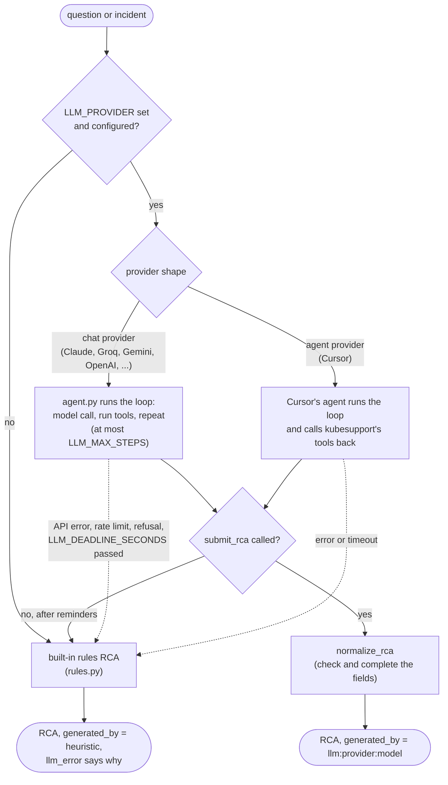
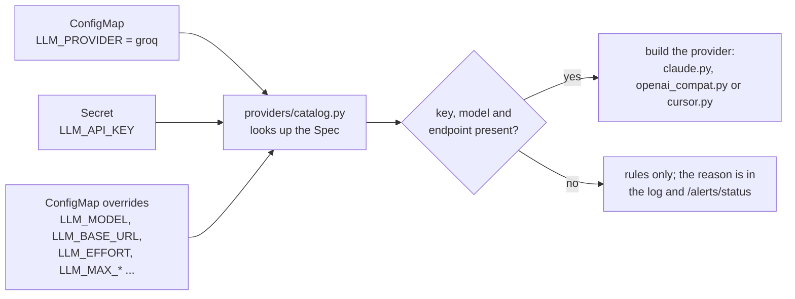
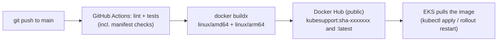

# Architecture: how kubesupport is built

kubesupport is a **read-only Kubernetes support agent** that runs as one pod in an EKS cluster and talks to people through **Microsoft Teams**. This document explains the moving parts, how data flows between them, and why it was built this way.

- **New to the project?** Read this page first, then [CODE_WALKTHROUGH.md](CODE_WALKTHROUGH.md) for the code.
- **Installing it?** Go to [INSTALLATION.md](INSTALLATION.md).

All diagrams are [Mermaid](https://mermaid.js.org/); GitHub renders them in place.

---

## 1. What it does, in one picture

| It… | How |
|---|---|
| **Watches** the cluster | Every minute it looks for crash loops, OOM kills, image-pull failures, config errors, stuck Pending pods, pods that can't be created, failed Jobs, evictions and NotReady nodes. |
| **Diagnoses** new problems | A root cause analysis (RCA) by an AI model of your choice, or by built-in rules when no model is configured. |
| **Alerts** in Teams | An Adaptive Card with the root cause and fix steps; a reminder while it lasts; a "Resolved" card when it's over. |
| **Reports activity** | Once a minute: *who* exec'd into a pod, created or deleted a service or app, changed permissions, changed an image or scaled. |
| **Answers questions** | `@kubesupport status`, `@kubesupport logs payments/api-…`, or any question in plain words, from a Teams channel. |
| **Never changes anything** | Read-only permissions on the whole cluster, never Secrets. |

---

## 2. Components

### 2.1 Inside the kubesupport pod

| Module | Responsibility |
|---|---|
| [`main.py`](../agent/main.py) | Entrypoint. Runs the internal API (8000), the Teams-only app (8080) and, when its certificate is mounted, the activity webhook (8443). |
| [`app.py`](../agent/app.py) | FastAPI apps. `app`: internal API (`/rca`, `/chat`, `/alerts/*`, `/activity*`, probes). `teams_app`: nothing but `POST /teams/webhook`. Starts the watcher and the activity feed. |
| [`teams.py`](../agent/teams.py) | Everything Teams: verifies the HMAC signature, parses commands, answers within Teams' 5-second limit, hands slow work to a thread pool, posts cards to Workflows webhooks with retries. |
| [`watcher.py`](../agent/watcher.py) | The incident loop: detect → RCA → alert, reminders, "Resolved", startup summary, hourly AI budget. |
| [`tools.py`](../agent/tools.py) | Read-only Kubernetes access: pods, logs, events, deployments, any object kind (never Secrets); redaction of secrets in text; `detect_incidents()`. |
| [`agent.py`](../agent/agent.py) | The AI investigation engine: the AI's rules (system prompt), the `submit_rca` tool, the tool loop, the deadline, `normalize_rca`. |
| [`rules.py`](../agent/rules.py) | Built-in diagnosis: an evidence-based RCA without AI ([RULES.md, section 4](RULES.md#4-built-in-diagnosis-rules)). |
| [`timefmt.py`](../agent/timefmt.py) | Shows times in the `TIMEZONE` zone. |
| [`providers/`](../agent/providers) | AI providers, one folder: [`catalog.py`](../agent/providers/catalog.py) lists them all; `LLM_PROVIDER` picks one. See [AI_PROVIDERS.md](AI_PROVIDERS.md). |
| [`activity.py`](../agent/activity.py) | Turns admission requests into "who did what" events, filters noise, batches one card per minute. |
| [`cards.py`](../agent/cards.py) | Builds every Adaptive Card (alert, resolved, startup, RCA, answer, activity, test) and keeps them under Teams' size limit. |
| [`report.py`](../agent/report.py), [`templates/`](../agent/templates) | HTML version of the last RCA (`/rca/latest`). |
| [`cli.py`](../agent/cli.py) | The same features from a terminal, against your kubeconfig. |

### 2.2 Kubernetes objects

| File | Creates |
|---|---|
| [`deploy/deployment.yaml`](../deploy/deployment.yaml) | Namespace, ServiceAccount, read-only RBAC, ConfigMap, Deployment, Services `kubesupport` and `kubesupport-teams`, NetworkPolicy |
| [`deploy/activity-webhook.yaml`](../deploy/activity-webhook.yaml) | Service `kubesupport-webhook`, ValidatingWebhookConfiguration `kubesupport-activity` (applied by [`webhook-cert.sh`](../deploy/webhook-cert.sh) with the CA filled in) |
| [`deploy/cloudflare-tunnel.yaml`](../deploy/cloudflare-tunnel.yaml) | Deployment `kubesupport-tunnel` (2 × cloudflared), PodDisruptionBudget, NetworkPolicy |

The Secrets `kubesupport-secrets` and `kubesupport-tunnel` are created by hand with `kubectl` (INSTALLATION.md, Steps 5 and 8), so no key is ever in Git.

---

## 3. The four flows

The exact rules behind each flow (what counts as an incident, when a card is sent, what the AI must do) are in [RULES.md](RULES.md).

### 3.1 Incident alert

Incident life cycle:

On startup, incidents that already exist are summarised in **one** "kubesupport started" card instead of one alert each.

### 3.2 Question from Teams

Teams waits at most **5 seconds** for an outgoing webhook's reply, so anything slower is answered through the channel's Workflows webhook. kubesupport sends the question's thread (`threadMessageId`) with the card; the workflow's **Reply with an adaptive card in a channel** action puts it under the question ([INSTALLATION.md, Step 4.2](INSTALLATION.md#42-answers-in-the-questions-channel--t2)). A workflow that still uses "Post card" starts a new post instead.

### 3.3 Cluster activity

The webhook is registered with `failurePolicy: Ignore` and a 3-second timeout, so nothing in the cluster is ever blocked, even when kubesupport is down.

### 3.4 Investigation with an AI provider

The model only ever sees **kubesupport's own read-only tools**: `list_pods`, `describe_pod`, `get_events`, `get_pod_logs`, `get_deployment`, `top_pods`, `search_runbooks`, `scan_cluster_for_issues`, `list_resources`, `get_resource`, and `submit_rca`. Tool output is redacted and wrapped in `<untrusted_data>` before the model sees it.

---

## 4. Choosing the AI provider

One image contains every provider. `LLM_PROVIDER` decides which one is used; nothing else is ever called. Details for each provider: [AI_PROVIDERS.md](AI_PROVIDERS.md).

---

## 5. Build and delivery

- [`.github/workflows/ci.yml`](../.github/workflows/ci.yml) runs flake8 and pytest on every pull request and push. On `main` it builds and pushes the image.
- The image ([`agent/Dockerfile`](../agent/Dockerfile)) contains every AI provider. `--build-arg WITH_CURSOR=false` leaves out the Cursor SDK, which has a proprietary licence.
- Deploys are manual and explicit: `kubectl apply` of the files in `deploy/`. There is no Helm chart and no Terraform, on purpose.

---

## 6. Design decisions

| Decision | Why | Trade-off |
|---|---|---|
| **Teams through Workflows webhooks + an outgoing webhook**, no bot | No Azure Bot Service or Entra app registration is available. An Entra app alone can't post ordinary Teams messages (Graph allows app-only sending only for migrations). Both features are configured with clicks. | Questions only from a standard channel; replies must come within 5 s, so long answers are separate posts. |
| **Admission webhook for activity** | `kubectl exec` never becomes a Kubernetes object or event; only an admission webhook sees it, with *who* did it. | Activity while kubesupport is down isn't reported (by design: nothing may be blocked). |
| **Read-only `view` role + a small extra ClusterRole** | Everything except Secrets, kept current by Kubernetes as new kinds appear. | RBAC objects need the extra role; Secrets are never readable. |
| **Cloudflare Tunnel** instead of a load balancer | The cluster opens the connection outward, so nothing in AWS accepts connections from the internet. Cloudflare's WAF lets only `POST /teams/webhook` through. | Questions depend on Cloudflare; alerts don't. |
| **Separate port 8080 for Teams** | Even with a Cloudflare mistake, the internal API can't be reached through the tunnel. | One more port and Service. |
| **Pluggable AI providers** (`providers/`) | Teams choose the provider they have keys and budget for: free (Groq, Gemini), paid (Claude, OpenAI, Cursor), or self-hosted (Ollama). | Quality and speed depend on the provider; free plans are slow. |
| **Rule-based fallback** | Alerts always carry a diagnosis, even without a model, over budget, or when the model fails. | Rule-based RCAs are generic. |
| **One replica, state in memory** | Simple; the watcher and the activity feed must run once. | Incidents and chat history reset on restart (the startup card covers it). |
| **Diagnosis and posting on a background worker** | A slow AI model or a Teams outage never delays the next scan; failed cards are retried. | Alerts for many simultaneous incidents arrive one after another. |
| **Liveness reflects the watcher** | `/healthz` fails when scanning stops (e.g. a hung API call) or the Teams server dies, so Kubernetes restarts the pod instead of it silently not alerting. | A restart loses in-memory state. |
| **Built-in rules quote their evidence** | A diagnosis without AI is still specific and honest about its confidence. | Rules only know common failure types. |
| **Internal API closed without a key** | Nothing in the cluster can trigger RCAs or Teams posts unless it has `AGENT_API_KEY`. | One more secret to set. |
| **Manual `kubectl apply`, no Helm or Terraform** | Easy to read, review and change. | Values are edited in the YAML files. |

Known limitations are listed in [OPERATIONS.md](OPERATIONS.md#limitations).
