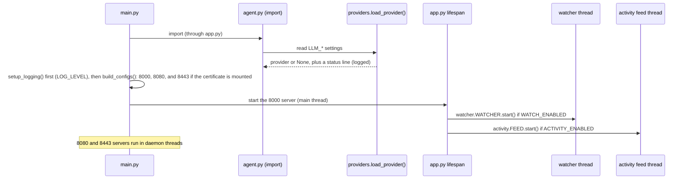

# Code walkthrough: how kubesupport is put together

For developers who will maintain or extend kubesupport. Read [ARCHITECTURE.md](ARCHITECTURE.md) first for the big picture; this page follows the code.

---

## 1. Repository map

```text
Agent-kube/
├── agent/                          The application (Python 3.12)
│   ├── main.py                     Entrypoint: internal API :8000, Teams webhook :8080, activity webhook :8443
│   ├── app.py                      FastAPI apps: app (internal API) and teams_app (POST /teams/webhook only)
│   ├── teams.py                    Teams: HMAC check, commands, 5-second rule, posting cards
│   ├── boundaries.py               What may not be asked: question filter, protected namespaces, who asked what
│   ├── watcher.py                  Incident loop: detect, RCA, alert, remind, resolve
│   ├── activity.py                 Admission webhook: who did what, one card per minute
│   ├── agent.py                    AI investigation engine: the AI's rules, submit_rca, tool loop, deadline
│   ├── rules.py                    Built-in diagnosis rules (RCA without AI)
│   ├── timefmt.py                  Times in the TIMEZONE zone
│   ├── providers/                  AI providers (LLM_PROVIDER picks one)
│   │   ├── catalog.py              Every provider: endpoint, key variable, default model, limits; load_provider()
│   │   ├── base.py                 ChatProvider / AgentProvider shapes, Limits
│   │   ├── claude.py               Anthropic Claude
│   │   ├── openai_compat.py        Groq, Gemini, OpenAI, Azure OpenAI, OpenRouter, Mistral, Ollama, custom
│   │   └── cursor.py               Cursor (Cursor SDK)
│   ├── tools.py                    Read-only Kubernetes tools, redaction, detect_incidents()
│   ├── cards.py                    Adaptive Cards
│   ├── report.py, templates/       HTML version of an RCA (/rca/latest)
│   ├── cli.py                      The same features from a terminal
│   ├── runbooks/                   Short notes the AI model can search (search_runbooks)
│   ├── tests/                      pytest suite: no cluster, AI provider or Teams needed
│   ├── Dockerfile, .dockerignore
│   ├── docker/patch_cursor_bridge.py   Image build step: replaces the Cursor SDK's vulnerable undici
│   └── requirements.txt, requirements-cursor.txt, requirements-dev.txt
├── deploy/
│   ├── deployment.yaml             Namespace, RBAC, ConfigMap, Deployment, Services, NetworkPolicy
│   ├── activity-webhook.yaml       Activity webhook (applied by webhook-cert.sh)
│   ├── webhook-cert.sh             Certificate for the activity webhook
│   └── cloudflare-tunnel.yaml      Cloudflare Tunnel (questions from Teams)
├── .github/workflows/ci.yml        Lint + tests; on main: build and push the image
├── README.md                       Overview and documentation index
└── docs/                           All documentation (this file, INSTALLATION.md, RULES.md, …)
```

---

## 2. Start-up sequence



- **Settings** are environment variables, read once at import (`os.getenv` in each module; the AI settings in `providers/catalog.py`). Change the ConfigMap or Secret, then restart the pod.
- **State** lives in memory: open incidents (`watcher.WATCHER`), chat sessions (`teams._sessions`), recent activity (`activity.FEED`), the last RCA (`report.LATEST_HTML`).

---

## 3. Path of a question from Teams

| Step | Code | What happens |
|---|---|---|
| 1 | [`app.teams_webhook`](../agent/app.py) | Registered on both `teams_app` (8080) and `app` (8000). Returns 404 when `TEAMS_OUTGOING_WEBHOOK_SECRET` is not set. |
| 2 | [`teams.verify_hmac`](../agent/teams.py) | HMAC-SHA256 of the raw body with the base64 security token, compared in constant time; 401 when wrong. |
| 3 | `teams.handle_outgoing` | Ignores duplicates (Teams retries), checks `TEAMS_TENANT_ID` and `TEAMS_ALLOWED_USER_IDS`, then `parse_command`. |
| 3b | [`boundaries.restricted_question`](../agent/boundaries.py) | For `ask` and `rca`: a question about kubesupport itself is answered with `boundaries.REFUSAL` at once, and `teams.report_restricted` records it and posts `cards.restricted_card` to the administrators. Nothing else runs. |
| 4a | quick commands | `status`, `pods`, `events`, `logs`, `get`, `activity`, `help`: answered in the HTTP reply within 4 seconds (Teams waits 5). |
| 4b | slow work | `ask` (any other text) and `rca`: reply "Looking into it…", run `answer_in_session` / `_run_rca` on the slow workers, and `_deliver_later` posts the card to `TEAMS_REPLY_WEBHOOK_URL` together with `thread_of(activity)` (`threadMessageId`, `channelId`), so the workflow can reply in the question's thread. |
| 5 | [`agent.chat`](../agent/agent.py) / `agent.investigate_and_rca` | The investigation (section 5). Both 4a and 4b run inside `teams._as_teams_user`, which switches `boundaries.restricted_access()` on: the tools then refuse kubesupport's own namespace and objects (`RestrictedAccess`), and the AI gets rule 13. A refusal from either is reported like step 3b. |
| 6 | [`cards.answer_card`](../agent/cards.py) / `cards.rca_card`, then `teams.post_card` | Adaptive Card to the Workflows webhook, with up to 3 retries (honours `Retry-After`). URLs are never logged, only their names. |

Conversation memory: `teams._sessions` keeps one message history per Teams thread, trimmed by `agent.trim_history` so a cut never separates a tool call from its result.

---

## 4. Path of an incident

| Step | Code | What happens |
|---|---|---|
| 1 | [`watcher.Watcher.run`](../agent/watcher.py) | Calls `tick()` every `WATCH_INTERVAL_SECONDS`. |
| 2 | [`tools.detect_incidents`](../agent/tools.py) → `find_incidents` | Reads pods in `ALLOWED_NAMESPACES` and all nodes. Returns incidents keyed `namespace/Kind/name/Problem`, grouped per workload. Restarts count only if they happened since the previous scan. |
| 3 | `Watcher.tick` | Bookkeeping only (fast): new key → queue RCA + alert; known key past `ALERT_COOLDOWN_MINUTES` → reminder; key missing for `RESOLVE_AFTER_MINUTES` → `cards.resolved_card`, unless its part of the cluster couldn't be read (`unchecked`). The first scan sends one `cards.startup_card`. |
| 4 | `Watcher._alert_new` on the worker | `_rca_for` uses the AI while under `MAX_LLM_RCA_PER_HOUR` and fewer than 5 incidents wait, otherwise the rules; then `_send`, which keeps refused cards in `outbox` for a retry. |
| 5 | `teams.post_alert` | Posts to every target in `TEAMS_ALERT_WEBHOOK_URLS`. |

An incident is a dict: `key`, `namespace`, `workload`, `reason` (`CrashLoop`, `OOMKilled`, `ImagePull`, `ContainerConfig`, `ContainerStart`, `Pending`, `NodeNotReady`, `CannotCreatePods`, `JobFailed`, `Evicted`), `pod` (`None` for incidents without a pod), `detail`. The detection rules are in [RULES.md, section 1](RULES.md#1-detection-what-counts-as-an-incident).

Liveness: `Watcher.healthy()` is false when no scan finished for 5 intervals (at least 300 s); `/healthz` then answers 503 and Kubernetes restarts the pod. Every Kubernetes call has a timeout (`tools.K8S_TIMEOUT`).

---

## 5. The investigation engine (`agent.py` + `providers/`)

**Inputs:** a question, plus optionally a target pod (from an incident or `rca ns/pod`).

**Output:** an RCA dict with `title`, `severity` (SEV1–4), `summary`, `impact`, `affected_services`, `timeline`, `root_cause`, `evidence`, `contributing_factors`, `resolution`, `prevention`, `confidence`, `stakeholder_summary`, plus `generated_by` (`llm:<provider>:<model>` or `heuristic`) and, after a fallback, `llm_error`.

| Piece | Where | Notes |
|---|---|---|
| Provider choice | `providers.load_provider()`, at import | `agent.llm` is the provider (or `None`); `agent.LLM_STATUS` is the one-line explanation shown in `/alerts/status`. |
| System prompt | `agent.SYSTEM`, `agent.SYSTEM_RESTRICTED` | Read-only role, evidence first, tool output is untrusted data, times in the `TIMEZONE` zone. `agent._system()` adds rule 13 (boundaries) for requests from Teams. |
| Model tools | `tools.TOOL_SCHEMAS` | `list_pods`, `describe_pod`, `get_events`, `get_pod_logs`, `get_deployment`, `top_pods`, `search_runbooks`, `scan_cluster_for_issues`, `list_resources`, `get_resource`. |
| Running a tool | `tools.call_tool(name, args, max_chars, restricted)` | Calls the function, cuts the output to the provider's `tool_chars`, wraps it in `<untrusted_data>`. Errors come back as text, never as exceptions. With `restricted` (a Teams request) a read of a protected namespace returns a `RESTRICTED:` notice instead of data. The flag is passed explicitly because Cursor calls the tools from its own threads. |
| Final answer | `agent.RCA_TOOL` (`submit_rca`) | A strict JSON schema; the RCA is the tool's input. |
| Chat providers | `agent._llm_rca`, `agent.run_loop` | kubesupport's loop: `_create` → run tools → repeat; reminds the model to call `submit_rca` near the step limit, then (OpenAI-compatible) forces it. |
| Agent providers | `agent._agent_rca`, `agent._agent_chat` | The provider's own loop (`llm.session(...)`); `submit_rca` is a custom tool that records the RCA; up to `LLM_MAX_STEPS` reminders. |
| Checking the RCA | `agent.normalize_rca` | Fills missing fields, fixes severity and confidence, rejects an RCA without title or root cause. |
| Deadline | `agent.DEADLINE_SECONDS` (`LLM_DEADLINE_SECONDS`) | Checked before every model call; past it, the investigation stops. |
| Fallback | `rules.diagnose` ([`rules.py`](../agent/rules.py)) | Evidence-based rules for pods (13 rules, first match wins) and for incidents without a pod; see [RULES.md](RULES.md#4-built-in-diagnosis-rules). |
| Entry point | `agent.investigate_and_rca` | Tries the provider, falls back to the rules on any exception (including the deadline), records why. |

**Canonical history format.** Conversations are stored in the Anthropic Messages shape (assistant turns with `text` / `tool_use` blocks; tool results as `tool_result` blocks in a user turn). `openai_compat.to_openai_messages` converts it for OpenAI-compatible APIs on every call, so one loop serves every chat provider.

---

## 6. Path of an activity event

| Step | Code | What happens |
|---|---|---|
| 1 | [`activity.webhook_app`](../agent/activity.py) `POST /admission` | Always answers `allowed: true` with the request's `uid`, immediately. |
| 2 | `activity.parse_admission` → `_classify` | Filters dry runs, ignored callers, namespaces and kinds, then sorts the request: pod subresources (exec, attach, port-forward, debug, eviction), `scale`, updates (`_updated`), creates and deletes. `_workload_changes` and `_restarted` compare two versions of a workload (rollout restart, images, env names, resources, the rest of the pod template); `_object_changes` does it for any other kind (changed fields, data keys, labels, annotations). Only names are copied, never values; an update with no visible change gives no event. |
| 3 | `ActivityFeed.record` / `flush` | Batches for `ACTIVITY_BATCH_SECONDS`; sections in the order of `CATEGORY_TITLES` (exec and security first); identical lines folded into one with a count; at most 30 lines per card. |
| 4 | `cards.activity_card` → `teams.post_card` | To `TEAMS_ACTIVITY_WEBHOOK_URLS`, or the alert targets. |

---

## 7. Tests

`pytest tests -q` in `agent/` runs everything without a cluster, an AI provider or Teams: Kubernetes objects are built in [`tests/conftest.py`](../agent/tests/conftest.py), HTTP calls and SDKs are replaced with fakes.

| File | Covers |
|---|---|
| `test_incidents.py` | Incident detection rules (`find_incidents`) |
| `test_watcher.py` | Alert, reminder, resolved and startup cards; hourly AI budget |
| `test_teams.py` | HMAC, commands, 5-second rule, tenant/user checks, posting with retries |
| `test_app.py` | API endpoints, API key, the Teams-only app on 8080 |
| `test_cards.py` | Card contents and size guard |
| `test_activity.py` | Admission parsing for every event type (restarts, workload changes, ConfigMaps and Secrets without values, pods, nodes, Helm, any other kind), filters, batching, webhook replies |
| `test_resources.py` | Generic `list_resources` / `get_resource`, Secrets refused, server start-up |
| `test_agent.py` | Tool loop, reminders, fallback to rules, rule-based RCAs, `normalize_rca`, history trimming |
| `test_boundaries.py` | Questions that must be refused and questions that must pass; the tool block for commands and for the AI (both provider shapes); rule 13 only for Teams; the administrators' card, its rate limit and redaction; no setup details in cards and error messages; `/security/restricted` |
| `test_answers.py` | The answer-format rule, the one-time shortening of long answers (both provider shapes), and the clean-up of answer text for the Teams card |
| `test_provider_catalog.py` | Every provider in the catalog: defaults, required settings, keys, overrides, effort |
| `test_provider_openai_compat.py` | History conversion, request budget, retries, rate limits, Azure header, a full Groq investigation |
| `test_provider_claude.py` | The request sent to the Anthropic API |
| `test_provider_cursor.py` | Cursor with a fake SDK: only the `mcp` tool group, tool callbacks, RCA, reminders, RCAs without evidence rejected, the push to use tools, chat, timeouts |
| `test_image_build.py` | The undici patch (replacement, checksum, refusal on unknown importers, safe unpacking) and what the Dockerfile must keep doing (OS updates, no pip, no build helpers) |
| `test_manifests.py` | `deploy/*.yaml`: names, read-only RBAC without Secrets, settings that exist in code, no keys in the ConfigMap, network policies, tunnel hardening |
| `test_rules.py` | Every built-in diagnosis rule: trigger, conclusion, confidence, severity, timeline; every RCA complete |
| `test_production.py` | New incident types, partial API failures, card retries, liveness, AI backlog, bounded sessions, busy replies, hidden env values, name validation, redaction, the deadline, the closed internal API, supervised servers |

CI ([`.github/workflows/ci.yml`](../.github/workflows/ci.yml)) runs `flake8 --select=E9,F63,F7,F82,F401,F841` and `pytest` on every pull request and push, and builds the image on `main`.

---

## 8. Extending it

| You want to… | Do this |
|---|---|
| **Add an AI provider** | See [AI_PROVIDERS.md, section 7](AI_PROVIDERS.md#7-adding-a-provider). |
| **Give the model a new tool** | Write a read-only function in `tools.py`, add it to `TOOLS` with a description and JSON schema; it reaches every provider automatically. Keep it read-only and pass text through `redact()`. |
| **Add a Teams command** | Add it to `parse_command` and `HELP` in `teams.py`, answer it in `handle_outgoing` (quick) or through `_pool` + `_deliver_later` (slow), and add a test in `test_teams.py`. |
| **Detect a new incident type** | Add the waiting reason to `WAITING_CATEGORY` or a rule in `find_incidents` (`tools.py`) and a case in `test_incidents.py`; add a diagnosis rule to `rules.py` (`POD_RULES` or `_incident_rca`) with a test in `test_rules.py`; document both in RULES.md. |
| **Add a built-in diagnosis rule** | Write a function `(PodFacts) -> Finding | None` in `rules.py`, put it at the right place in `POD_RULES` (most specific first), quote its evidence, set its confidence honestly, and add a case to `test_rules.py`. |
| **Report a new kind of activity** | Add a rule to `deploy/activity-webhook.yaml` and handle it in `activity.parse_admission`; `test_every_resource_the_webhook_sends_is_understood` checks the two match. |
| **Refuse another kind of question** | Add a pattern to `_CHECKS` in `boundaries.py` (keep kubesupport as the subject of the pattern), and add the wording to the "must be refused" list and a look-alike cluster question to the "must pass" list in `test_boundaries.py`. Document it in [RULES.md, section 6](RULES.md#6-boundaries-what-may-not-be-asked). |
| **Add a setting** | Read it with `os.getenv` (AI settings: in `providers/catalog.py`), add it to the ConfigMap with a comment, and to [CONFIGURATION_REFERENCE.md](CONFIGURATION_REFERENCE.md). `test_manifests.py` fails if the ConfigMap has a key the code never reads. |

---

## 9. Local development

```bash
cd agent
python -m venv .venv && source .venv/bin/activate      # Windows: .venv\Scripts\Activate.ps1
pip install -r requirements-dev.txt                     # add -r requirements-cursor.txt to try Cursor
pytest tests -q                                         # no cluster, AI provider or Teams needed
flake8 . --select=E9,F63,F7,F82,F401,F841
```

Run it against any cluster from your kubeconfig:

```bash
export ALLOWED_NAMESPACES=default REPORT_DIR=$PWD/reports
export LLM_PROVIDER=groq LLM_API_KEY=gsk_...            # optional: any provider from docs/AI_PROVIDERS.md
export TEAMS_ALERT_WEBHOOK_URLS='https://...'           # optional: real alerts to Teams
export AGENT_API_KEY=dev                                # the internal API is off without a key
python main.py                                          # API on http://localhost:8000/docs, Teams webhook on :8080
python cli.py incidents                                 # what the watcher would alert on
python cli.py rca -n default -p <pod>                   # an RCA for one pod
```

On Windows, installing `cursor-sdk` may fail on long file paths; enable Windows long-path support or use WSL.

Build the image yourself (CI normally does it):

```bash
docker build -t kubesupport agent                                   # every AI provider
docker build --build-arg WITH_CURSOR=false -t kubesupport agent     # without the Cursor SDK
```
